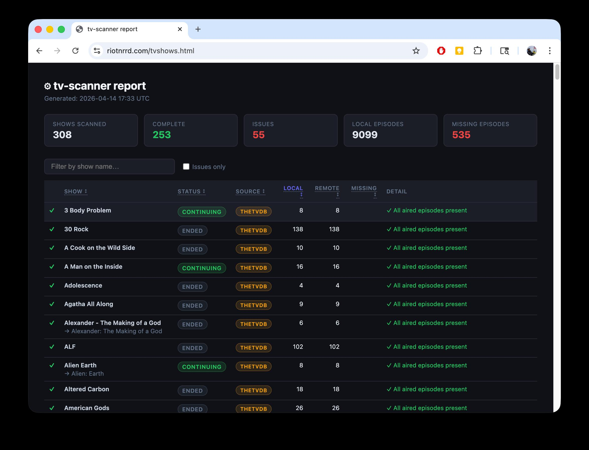
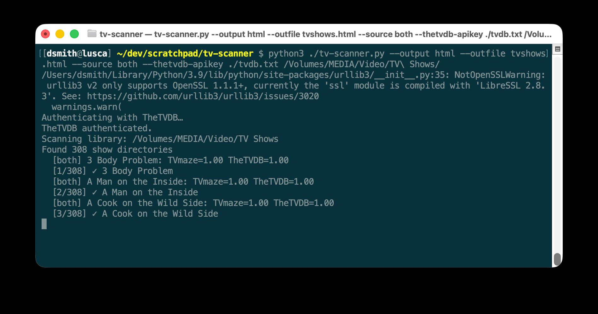

# tv-scanner

Scan a local TV library and compare it against [TVmaze](https://www.tvmaze.com/api) and optionally TheTVDB, TMDB and Episodate to find missing or extra episodes. Produces a self-contained HTML report with hover-over explanations, season file lists, and episode name tooltips.

## Screenshots

### HTML report


### Terminal output


## Requirements

- Python 3.9+
- `requests`

### Quick setup

```bash
cd tv-scanner
python3 -m venv .venv
source .venv/bin/activate
pip install -r requirements.txt
```

### macOS note

The system Python on older macOS releases can be awkward with SSL and package installs. Use Homebrew Python if you hit issues:

```bash
brew install python@3.11
python3.11 -m venv .venv
source .venv/bin/activate
pip install -r requirements.txt
```

No API key is needed for TVmaze or Episodate. TheTVDB and TMDB each need an API key file.

## Quick start

```bash
# Scan a TV library and open the HTML report
python3 tv-scanner.py /media/external/TV --html
open report.html      # macOS
xdg-open report.html  # Linux
```

## Usage

```bash
python3 tv-scanner.py /path/to/tv/root [options]
```

### Options

| Flag | Default | Description |
|------|---------|-------------|
| `--output text\|json\|csv\|html` | `text` | Primary output format |
| `--html [FILE]` | — | Also write an HTML report. Omit `FILE` to write `report.html` in the current directory. |
| `--missing-only` | off | Only show shows with gaps |
| `--workers N` | `4` | Parallel API workers |
| `--outfile PATH` | stdout | Write primary output to file |
| `--source LIST` | `tvmaze` | Databases to query, comma-separated (see [Databases](#databases)) |
| `--thetvdb-apikey PATH` | unset | Path to file containing TheTVDB API key |
| `--tmdb-apikey PATH` | unset | Path to file containing a TMDB API key or read access token |
| `--prefer-animation` | off | Favour animated series when choosing between candidates — use for a cartoon-only library |
| `--no-color` | off | Disable ANSI colour output |
| `--overrides FILE` | `~/.config/tv-scanner/overrides.json` | JSON file pinning folders to show IDs (see below) |
| `--cache-ttl HOURS` | `24` | How long cached API responses stay fresh |
| `--cache-dir DIR` | `~/.cache/tv-scanner` | Where API responses are cached |
| `--refresh` | off | Ignore cached responses for this run and replace them |
| `--no-cache` | off | Do not read or write the cache |

### Examples

```bash
# Basic scan — print to terminal and save an HTML report
python3 tv-scanner.py /media/usb/TV --html

# Only show problems, HTML saved to a specific path
python3 tv-scanner.py /media/usb/TV --missing-only --html ~/reports/tv.html

# Machine-readable JSON
python3 tv-scanner.py /media/usb/TV --output json --outfile report.json

# CSV for spreadsheet import
python3 tv-scanner.py /media/usb/TV --output csv --outfile report.csv

# Query both TVmaze and TheTVDB, pick best match per show
python3 tv-scanner.py /media/usb/TV --source both --thetvdb-apikey ~/.config/thetvdb.key

# Cartoon library: every database you have keys for, favouring animated series
python3 tv-scanner.py /media/usb/Cartoons --source all --prefer-animation \
    --tmdb-apikey ~/.config/tmdb.key --thetvdb-apikey ~/.config/thetvdb.key --html
```

## Databases

| `--source` name | Database | API key | Notes |
|---|---|---|---|
| `tvmaze` | [TVmaze](https://www.tvmaze.com) | none | Default. Good for mainstream TV. |
| `episodate` | [Episodate](https://www.episodate.com) | none | Patchier data, but lists many older and obscure cartoons the others miss. |
| `thetvdb` | [TheTVDB](https://thetvdb.com) | `--thetvdb-apikey` | Broad coverage; often numbers cartoon segments individually. |
| `tmdb` | [The Movie Database](https://www.themoviedb.org) | `--tmdb-apikey` | Strong on animation. Free key: create an account, then *Settings → API*. Either the "API Key" or the "API Read Access Token" works. |

Give several, comma-separated (`--source tvmaze,tmdb,episodate`). `both` is short for `tvmaze,thetvdb`; `all` uses every database that is usable with the keys you supplied. With more than one database, each show is matched against all of them and uses whichever episode list fits your files best — so one show can come from TMDB and the next from TVmaze. More databases means more requests on the first run; later runs come from the cache.

### Cartoons

- `--prefer-animation` nudges the choice toward animated series, so a folder called `Batman` in a cartoon library leans to an animated *Batman* rather than the 1966 live-action show.
- Cartoon episodes often bundle several segments (`Dee Dee's Room / Star Spangled Sidekicks`). Episode-title matching works on individual segments in both directions, so files named per segment still match databases that list combined episodes, and vice versa.
- Databases disagree most on cartoons (per-segment vs. per-episode numbering, airing vs. production order). Using several lets the scanner pick the numbering that matches how your files are numbered.

## Understanding the HTML report

The report is a single `.html` file you can open in any browser. Every **column header**, **status badge**, **source badge**, and **episode tag** has a hover-over tooltip.

### Summary cards

Shows scanned, complete shows, shows with gaps or errors, **matches to review** (uncertain or unmatched shows), episodes on disk (with the share of all aired episodes you have), and missing episodes.

### Columns

Click any column header to sort; the arrow shows the current sort.

| Column | Plain English |
|--------|--------------|
| **Show** | Your folder name, plus the series it was matched to when that differs. `⚠` marks an uncertain match, `📌` a pinned one. **Click the show to expand it.** |
| **Status** | Whether the show is still airing. |
| **Source** | Which database the episode list came from. |
| **Episodes** | Aired episodes you have / aired episodes that exist, with a completeness bar. Sorts by percentage. Specials and unaired episodes are excluded. |
| **Missing** | How many aired episodes are not found on disk. |
| **Detail** | Gaps as episode ranges (`E05–E13`) — hover a range for episode names and air dates. Runs of wholly absent seasons are merged (`S02–S13 entirely missing`). Also lists episodes on disk that the source doesn't know about, and files with no recognisable episode number. |

### Expanded show panel

Clicking a show opens a panel with:

- **Match** — the series it was matched to (linked to its TVmaze / TheTVDB page), the confidence and the evidence, and the other candidates considered. Each candidate comes with a ready-to-copy line for the overrides file, so fixing a wrong match is copy-and-paste.
- **On disk** — per season, which episodes you have and the folder they are in.

### Filtering

- **Search box** — filter by folder name or matched title
- **Gaps or errors only** — hide complete shows
- **Matches to review only** — show only uncertain or unmatched shows
- **Expand all / Collapse all** — open every visible show's panel

The report follows your system's light or dark appearance.

## How shows are identified

Many shows share a name (*The Office*, *Doctor Who*, *Ghosts*, *Shameless* …), so the scanner does not just take the first search result. For each folder it considers the top search results from each source and scores every candidate on:

1. **Episode titles** (strongest signal) — titles parsed from your filenames (`S02E01 - The Dundies.mkv`, `Show.S02E01.The.Dundies.1080p.WEB-DL.mkv`) are fuzzy-matched against each candidate's episode names. A title matching the same season/episode number scores fully; one found under a different number (alternate ordering) scores partially. Generic titles such as `Episode 4` or `Pilot` are ignored.
2. **Episode numbering** — how many of your season/episode numbers exist in the candidate.
3. **Show name** — similarity between the folder name and the candidate's title/aliases.
4. **Year** — a year in the folder name (`Doctor Who (2005)`) strongly favours the candidate that premiered then.

With `--source both`, the same scoring also decides which database's numbering fits your files best.

The report shows a **match confidence** for each show (hover the show name in the HTML report) along with the other candidates considered. Matches are flagged `⚠` when confidence is low or when a different show scored almost as well — typically folders whose filenames carry no episode titles. Pin these with the overrides file (below).

### Pinning a show (overrides)

When the scanner can't tell two shows apart — or picks the wrong one — pin the folder to an exact ID in an overrides file. It lives outside the library, at `~/.config/tv-scanner/overrides.json` (or any path via `--overrides`), and maps your existing folder names to IDs:

```json
{
  "House of Cards": "tvdb:12345",
  "The Office": "tvmaze:12345"
}
```

IDs can be from any database: `tvmaze:`, `tvdb:`, `tmdb:` or `episodate:`.

(The IDs above are placeholders — look up the real ones: the number in the show's URL on tvmaze.com or themoviedb.org, or the "TheTVDB.com Series ID" on a thetvdb.com series page. Easier: expand the show in the HTML report and copy the ready-made line for the candidate you want.) A pinned show skips searching entirely and is reported with 100% confidence ("pinned by overrides file"). Pins apply regardless of `--source`; `tvdb` pins need `--thetvdb-apikey` and `tmdb` pins need `--tmdb-apikey`.

## The library is read-only

tv-scanner only ever *reads* your media library. It never creates, renames, moves or deletes anything in it, and it does not rely on special file or folder names to carry its own metadata — corrections go in the overrides file, not into the library. Everything the tool writes (reports, the API cache) or owns (the overrides file) must live outside the library root; if you point `--html`, `--outfile`, `--cache-dir` or `--overrides` at a path inside it, the tool exits with an error instead.

## Caching

API responses (searches and episode lists) are cached on disk for 24 hours, so re-running a scan is near-instant and makes almost no network requests. The run summary shows how many requests were fetched vs. served from cache. Use `--refresh` after new episodes air if you don't want to wait for the cache to expire, `--cache-ttl` to change the lifetime, or `--no-cache` to bypass it. API keys and tokens are never written to the cache.

## Directory structure expected

```text
TV Root/
├── Breaking Bad/
│   ├── Season 1/
│   │   ├── Breaking.Bad.S01E01.mkv
│   │   └── …
│   └── Season 2/
│       └── …
├── The Wire/
│   └── …
└── …
```

Season folder names are flexible — `Season 1`, `S01`, `s1`, `Season_01`, `1` all parse correctly.
Episode filenames are parsed by common patterns like `S01E02`, `S01E01-E03`, `S01E01E02`, and `1x02`.

## Notes

- Only aired episodes are checked by default.
- Specials / non-regular episode types are excluded.
- AppleDouble sidecar files like `._Episode.mkv` are ignored.
- If a show is matched to the wrong series, pin it in the overrides file — no need to rename anything in the library.
